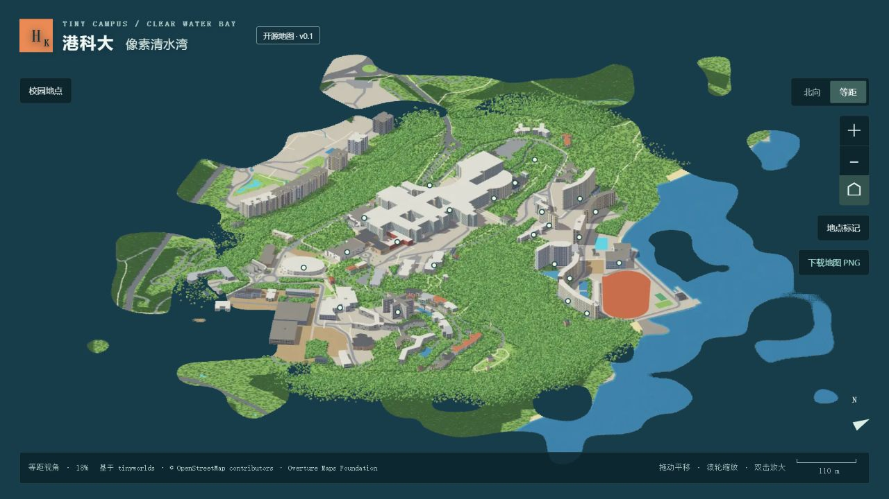

# tinyworlds_HKUST

**An open-source isometric pixel-art map of HKUST's Clear Water Bay campus, based on [tinyworlds](https://github.com/nihey/tinyworlds) by Nihey Takizawa (MIT).**

[中文完整文档](README.md) · [Attribution](ATTRIBUTION.md) · [Contributing](CONTRIBUTING.md)



This independent community project turns open geographic data into a browsable campus map. It includes two map orientations, a standalone viewer with bilingual place search, high-resolution PNG exports, the vendored generation pipeline, HKUST-specific configuration and the geographic extract used to generate the map. It is not affiliated with HKUST or an official tinyworlds release.

## Run the existing map

Use Node.js 24 (minimum 22.12). No npm dependencies are needed to serve the bundled viewer.

```sh
git clone https://github.com/ShawnZhang0318/tinyworlds_HKUST.git
cd tinyworlds_HKUST
npm run dev
```

Open **http://127.0.0.1:5180/**. For a different port, use `npm run dev -- --port 5181`. Any static HTTP server can also serve `web/`; opening `index.html` through `file://` will not work because the viewer loads JSON and tile assets with `fetch`.

Drag to pan, scroll or double-click to zoom, and use the north / isometric controls to change orientation. Search or choose a location from the campus list. Arrow keys, `+`, `-` and `Home` work while the map has keyboard focus. The current standalone viewer does not expose the upstream Street Walk or quiz interfaces, although their generated data is retained.

## Downloaded artwork

- [North-up map](web/hkust-campus.png): 5400 × 3038 PNG.
- [Isometric map](web/hkust-campus-isometric.png): 5550 × 3075 PNG.
- [Academic-building detail](web/hkust-academic-detail.png): 1400 × 900 PNG.

## Regenerate

```sh
npm run pipeline:install
npm run generate
```

This uses the included, checksummed geographic snapshot. Initial npm installation and installation of DuckDB's platform-specific spatial extension require network access. Explicitly refreshing the pinned source release also requires Python 3 (standard library only):

```sh
npm run generate -- --refresh
```

The refresh updates source extracts, checksums and map outputs. It does not automatically upgrade the pinned Overture release. The full regeneration and customization guide is in the [Chinese README](README.md#重新生成地图).

## Provenance and limitations

The projection, scene builder, geometry handling, software rasterizer, palette, shadows and tile pipeline come from tinyworlds commit [`0d48a72688875b9642dca48ea63405f0704e40de`](https://github.com/nihey/tinyworlds/tree/0d48a72688875b9642dca48ea63405f0704e40de). This project adds the HKUST definition, STAC partition selection, extracted campus landmarks, a schematic Red Bird, a standalone viewer and portable generation scripts. The upstream renderer is not claimed as original work. See [docs/UPSTREAM.md](docs/UPSTREAM.md) and [UPSTREAM.json](UPSTREAM.json).

Data release: Overture **2026-10-21.0**. Map generation: **2026-11-25**. Query bounds: `114.2525, 22.328, 114.274, 22.3435` (west, south, east, north; WGS84). The university land-use geometry and edge fog control the rendered area.

Ground is flat: campus slopes and floor-level changes are not reconstructed. Missing heights, facade details, roof details and some trees are procedural approximations. Edge-fog fragments are rendering boundaries, not real islands. This is a stylized exploration / prototyping map, not a surveyed model or navigation tool. The official campus map, university logos and reference photographs are not redistributed.

## Checks

```sh
npm run check
npm test
npm run pipeline:build
```

The last command requires the generator dependencies. Checks cover source checksums, license copies, tile completeness, indexed assets and PNG dimensions. Tests cover HTTP serving, downloads, missing files and path boundaries. CI runs these checks and compiles the pipeline.

## Licenses

| Material | Terms |
| --- | --- |
| Project code and documentation | [MIT](LICENSE) |
| Vendored tinyworlds source | Original [MIT](vendor/tinyworlds-pipeline/LICENSE), copyright 2026 Nihey Takizawa |
| Project's original raster-artwork contributions and descriptive text | [CC BY 4.0](MAPS_LICENSE.md), preserving underlying data rights |
| Source geography and derivative databases | [DATA_LICENSE.md](DATA_LICENSE.md); ODbL, CC BY and source-specific Places terms |

**© OpenStreetMap contributors, Overture Maps Foundation.** Land cover includes ESA WorldCover / Copernicus data. The Places extract retains provider metadata for Meta, Overture, Foursquare and AllThePlaces. Full notices, including Foursquare's NOTICE, are distributed in [LICENSES/](LICENSES/). Preserve the credits and applicable terms in **[ATTRIBUTION.md](ATTRIBUTION.md)** when redistributing or adapting the map.
