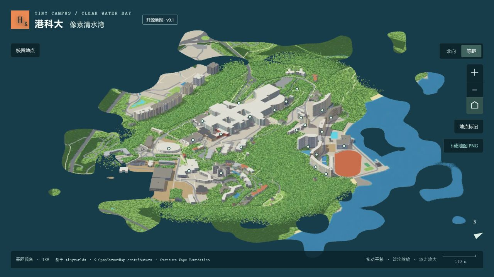

# tinyworlds_HKUST · 港科大像素地图

[](https://github.com/ShawnZhang0318/tinyworlds_HKUST-map/actions/workflows/check.yml)
[](LICENSE)
[](MAPS_LICENSE.md)

[English](README.en.md) · [上游 tinyworlds](https://github.com/nihey/tinyworlds) · [数据与署名](ATTRIBUTION.md) · [贡献指南](CONTRIBUTING.md)

**香港科技大学清水湾校园的开源等距像素地图，基于 [tinyworlds](https://github.com/nihey/tinyworlds) by [Nihey Takizawa](https://github.com/nihey)。**

本项目使用 tinyworlds 的场景构建、软件光栅渲染和瓦片生成流程，将公开的校园建筑轮廓、道路、海岸及土地覆盖数据转成可探索的像素地图。仓库同时提供生成结果、独立查看器、HKUST 配置、固定版本的生成器源码，以及用于复现的地理数据快照。

这是非校方官方的社区项目，也不是 tinyworlds 的官方发布。核心渲染算法来自 tinyworlds，原作者版权与 MIT 许可完整保留。



## 能做什么

- 拖动、滚轮缩放、双击放大，切换北向和等距两个视角。
- 按中英文地点名搜索，支持常用简繁名称；点击地点定位建筑。
- 浏览学术大楼、逸夫演艺中心、李兆基商学大楼、宿舍、运动场和海岸；红鸟在其地图位置以简化像素形体呈现。
- 下载高清 PNG，或直接使用仓库内的静态地图瓦片。
- 使用随仓库分发的源数据快照重新生成地图，也可显式重新下载固定版本的数据。

查看器通过静态文件运行，不需要账号、API Key、付费模型服务或应用后端。程序化渲染没有调用图像生成模型。

## 快速开始

需要 **Node.js 24**（本项目验证环境；最低版本为 22.12）。查看已生成的地图不需要安装 npm 依赖。

```sh
git clone https://github.com/ShawnZhang0318/tinyworlds_HKUST-map.git
cd tinyworlds_HKUST-map
npm run dev
```

打开 **http://127.0.0.1:5180/**。如果该端口已被占用：

```sh
npm run dev -- --port 5181
```

也可以用任意静态 HTTP 服务器托管 `web/`。例如安装了 Python 3 时：

```sh
python -m http.server 5180 --bind 127.0.0.1 --directory web
```

页面使用 `fetch` 加载地图数据，请通过 HTTP 打开，不要直接双击 `index.html`。

| 操作 | 作用 |
| --- | --- |
| 拖动地图 / 方向键 | 平移（键盘操作时先聚焦地图） |
| 滚轮、双击、加减按钮 / `+`、`-` | 缩放 |
| 全景按钮 / `Home` | 回到地图全景 |
| 北向 / 等距 | 切换完整的地图视角 |
| 校园地点 | 展开地点列表，搜索并定位 |
| 地点标记 | 显示或隐藏地图标记 |

## 地图文件

| 文件 | 尺寸 / 内容 |
| --- | --- |
| [北向完整地图](web/hkust-campus.png) | 5400 × 3038 PNG，透明背景 |
| [等距完整地图](web/hkust-campus-isometric.png) | 5550 × 3075 PNG，透明背景 |
| [学术大楼局部](web/hkust-academic-detail.png) | 1400 × 900 PNG |
| [`web/data/tinyhkust/`](web/data/tinyhkust/) | 北向五级瓦片、地标、搜索索引和原生步行数据 |
| [`web/data/tinyhkust/grid/`](web/data/tinyhkust/grid/) | 等距视角的瓦片和索引 |

北向、等距分别包含 107 和 111 个 WebP 瓦片文件。仓库保留 tinyworlds 原生 Street Walk 的数据契约，以及本项目编写的地标说明和题目数据；**当前独立查看器只提供地图浏览，没有接入 Street Walk 或答题界面**。

## 基于 tinyworlds 的范围

上游：[nihey/tinyworlds](https://github.com/nihey/tinyworlds)

作者：**Nihey Takizawa**

固定版本：[`0d48a72688875b9642dca48ea63405f0704e40de`](https://github.com/nihey/tinyworlds/tree/0d48a72688875b9642dca48ea63405f0704e40de)

上游协议：[MIT 原文](vendor/tinyworlds-pipeline/LICENSE)

| 来自 tinyworlds | 本项目新增 |
| --- | --- |
| 投影、几何处理、场景构建、像素调色板、阴影、光栅渲染、瓦片金字塔、索引与步行数据生成器 | HKUST 范围和建筑配置、校园边界与地标提取、STAC 分片筛选、数据快照、中文独立查看器、可移植的生成脚本、项目文档与验证 |

`vendor/tinyworlds-pipeline/` 保留原始管线及测试，没有引入上游的捐赠、账户、API、部署环境或视频项目。本项目没有将上游渲染器标为原创。变更清单见 [docs/UPSTREAM.md](docs/UPSTREAM.md)，机器可读记录见 [UPSTREAM.json](UPSTREAM.json)。

## 重新生成地图

生成器需要 Node.js、npm 和 DuckDB 的空间扩展。首次安装 npm 包或 DuckDB 扩展需要网络。仅在显式重新下载地图数据时需要 Python 3；Python 脚本只使用标准库。

```sh
npm run pipeline:install
npm run generate
```

默认流程读取 [`data/raw/`](data/raw/) 的已分发快照，验证并准备校园数据，编译 TypeScript，生成两个视角的场景、瓦片、索引和 PNG。它不会重新查询全球 Overture 数据，也不依赖本机原来的缓存目录。输出写回 `web/`。

要从同一固定版本的 Overture 目录重新下载：

```sh
npm run generate -- --refresh
```

此命令会更新源数据快照、来源清单、校验和及生成结果。它仍使用 `scripts/select-stac.py` 中固定的 `2026-10-21.0`，不是自动升级到最新数据；升级数据版本时需要同时检查 schema、许可和地图变化。

主要修改位置：

| 位置 | 内容 |
| --- | --- |
| `vendor/tinyworlds-pipeline/src/cities/tinyhkust.ts` | 范围、样式、边缘雾化、红鸟简化形体 |
| `vendor/tinyworlds-pipeline/prepare-hkust.mjs` | 从原始地理数据提取校园边界和地标位置 |
| `vendor/tinyworlds-pipeline/src/cities/tinyhkust.places.ts` | 上一步生成的地标配置；直接改动会在重建时被覆盖 |
| `scripts/select-stac.py` / `src/sources/overture-stac.ts` | 官方空间目录筛选 / 选中分片的下载适配器 |
| `scripts/generate.mjs` | 本项目完整生成流程 |
| `web/index.html`、`map.css`、`map.js` | 独立查看器 |

`src/sources/overture-stac.ts` 的完整路径位于 `vendor/tinyworlds-pipeline/` 内。无需修改原生渲染器即可调整校园配置和查看器。

## 数据、精度与限制

- 地理数据固定为 **Overture Maps 2026-10-21.0**，本地图于 **2026-11-25** 生成。
- WGS84 数据查询范围：西 `114.2525`、南 `22.328`、东 `114.274`、北 `22.3435`。实际呈现使用映射的大学用地边界及周围的雾化区域；相交要素可能延伸出查询框。
- 建筑轮廓、道路和海岸来自公开数据；**地面平面化，没有复现校园山坡或楼层高差**。
- 建筑高度优先采用数据中的高度或楼层，缺失部分由规则估算。外立面、屋顶细节和部分树木是程序化演绎；红鸟是示意形体。
- 地图边缘保留 tinyworlds 的雾化裁切效果，可能出现独立碎片。这些边缘不是新增岛屿或实际地理边界。
- 校园数据可能遗漏或滞后。本项目适合视觉探索、游戏原型和风格研究，不能用于实地导航或测量。
- 校方官方校园地图仅用于核对名称与位置，未将其图像、标识或照片放入仓库。

来源 URL 和每层许可见 [data/sources.json](data/sources.json)；源文件 SHA-256 见 [data/checksums.json](data/checksums.json)。Places 的原始提供方元数据保存在其 `sources` 列中，具体授权不能仅由目录中的 `other` 推断。

## 验证

```sh
npm run check
npm test
npm run pipeline:build
```

`check` 核对数据快照的校验和、协议副本、两套瓦片清单、地标描述和 PNG 尺寸；`test` 验证 HTTP 预览、地图数据、PNG 下载、缺失文件和路径边界。`pipeline:build` 需要先安装生成器依赖。GitHub Actions 在 push 和 Pull Request 上执行这些检查。

## 开源协议与署名

代码开放不代表第三方地理数据被重新授权为 MIT。本仓库按内容说明许可：

| 内容 | 协议 |
| --- | --- |
| 项目代码与文档 | [MIT](LICENSE)，保留 tinyworlds 原作者声明 |
| 上游 tinyworlds 管线 | [原始 MIT](vendor/tinyworlds-pipeline/LICENSE) |
| 本项目原创地图图像、截图和说明文字 | [CC-BY-4.0](MAPS_LICENSE.md)，不改变底层地理数据权利 |
| 地理源数据与派生数据库 | [DATA_LICENSE.md](DATA_LICENSE.md)：ODbL-1.0、CC-BY-4.0，以及 Places 的逐来源许可 |

完整第三方署名见 **[ATTRIBUTION.md](ATTRIBUTION.md)**，协议全文和 Foursquare NOTICE 均在 **[LICENSES/](LICENSES/)**。如果分发地图或进行二次开发，请随附相应的署名、协议及修改说明。

欢迎提交 [Issue](https://github.com/ShawnZhang0318/tinyworlds_HKUST-map/issues) 或 Pull Request；贡献方式见 [CONTRIBUTING.md](CONTRIBUTING.md)。
